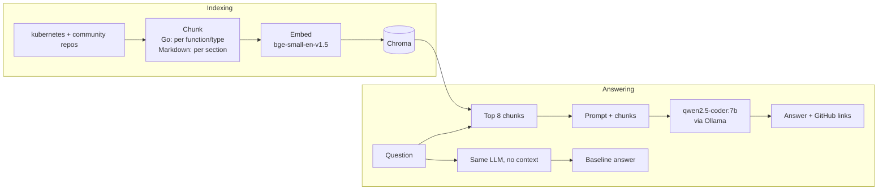

# Codebase Onboarding Assistant

Ask plain-English questions about the Kubernetes codebase and get answers backed by the actual code, with links to the exact lines on GitHub.

This is a school data science project. The question it tries to answer: does a RAG pipeline over real source code beat just asking an LLM? To find out, the same local model answers each question twice, once with retrieved code and once without.

## How it works



- **Code** is parsed with tree-sitter, so each chunk is a whole function, method or type along with its doc comment.
- **Docs** come from the Kubernetes contributor guides and are split by heading.
- **Vendored, generated and test code** is skipped.
- **Everything runs locally:** no API keys, no cost.

Current scope is the scheduler, kubelet and client-go, which is about 21,700 chunks.

## Setup

You need [uv](https://docs.astral.sh/uv/), git and [Ollama](https://ollama.com).

```bash
uv sync                                   # Python 3.12 + dependencies
uv run python -m src.ingestion.clone      # clone pinned repos into data/
uv run python -m src.ingestion.ingest     # chunk -> data/chunks.jsonl
uv run python -m src.retrieval.index      # embed -> chroma_db/ (slow; safe to stop and re-run)

ollama serve                              # in another terminal
ollama pull qwen2.5-coder:7b
```

## Usage

```bash
# RAG answer, sources, and baseline side by side
uv run python -m src.generation.ask "Which function in the scheduler picks the node for a pod?"

# just see what retrieval returns
uv run python -m src.retrieval.search "how does kubelet sync a pod"
```

## Project layout

```
src/
  config.py      paths, pinned versions, model names, top-k
  ingestion/     clone repos, find files, chunk Go and Markdown
  retrieval/     Chroma store, indexer, search
  generation/    Ollama LLM, prompts, RAG + baseline, ask CLI
  evaluation/    eval question loader and validator
eval/            evaluation questions
tests/           pytest suite
```

## Tests

```bash
uv run pytest -q
```

## Status

The pipeline works end to end. The eval set (40–60 hand-checked questions) is in progress. After that comes scoring with RAGAS plus retrieval hit@k, then a small Streamlit UI.
