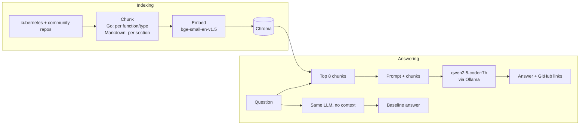

# Codebase Onboarding Assistant

Ask plain-English questions about the Kubernetes codebase and get answers backed by the actual code, with links to the exact lines on GitHub.

This is a school data science project. The question it tries to answer: does a RAG pipeline over real source code beat just asking an LLM? To find out, the same local model answers each question twice, once with retrieved code and once without.

## How it works



- **Code** is parsed with tree-sitter, so each chunk is a whole function, method or type along with its doc comment.
- **Docs** come from the Kubernetes contributor guides and are split by heading.
- **Vendored, generated and test code** is skipped.
- **Everything runs locally:** no API keys, no cost.

Current scope is the scheduler, kubelet and client-go, which is about 21,700 chunks.

## Setup

You need [uv](https://docs.astral.sh/uv/), git and [Ollama](https://ollama.com).

```bash
uv sync                                   # Python 3.12 + dependencies
uv run python -m src.ingestion.clone      # clone pinned repos into data/
uv run python -m src.ingestion.ingest     # chunk -> data/chunks.jsonl
uv run python -m src.retrieval.index      # embed -> chroma_db/ (slow; safe to stop and re-run)

ollama serve                              # in another terminal
ollama pull qwen2.5-coder:7b
```

## Usage

```bash
# web UI: answer with clickable GitHub links, retrieved chunks, optional baseline
uv run streamlit run app.py

# RAG answer, sources, and baseline side by side
uv run python -m src.generation.ask "Which function in the scheduler picks the node for a pod?"

# just see what retrieval returns
uv run python -m src.retrieval.search "how does kubelet sync a pod"
```

## Evaluation

52 hand-checked questions in `eval/questions.jsonl` (42 dev, 10 held-out test). Each step caches its output in `eval/results/`.

```bash
uv run python -m src.evaluation.retrieval   # hit@k and MRR, no LLM needed
uv run python -m src.evaluation.generate    # RAG + baseline answers (slow)
ollama pull llama3.1:8b                     # judge model
uv run python -m src.evaluation.score       # RAGAS metrics (very slow, hours)
uv run python -m src.evaluation.report      # means, Wilcoxon test, chart
```

Add `--split test` to run on the held-out questions.

## Project layout

```
src/
  config.py      paths, pinned versions, model names, top-k
  ingestion/     clone repos, find files, chunk Go and Markdown
  retrieval/     Chroma store, indexer, search
  generation/    Ollama LLM, prompts, RAG + baseline, ask CLI
  evaluation/    question validator, retrieval metrics, answer generation, RAGAS scoring, report
app.py           Streamlit UI
eval/            evaluation questions (results/ is git-ignored)
tests/           pytest suite
```

## Tests

```bash
uv run pytest -q
```

## Status

Pipeline, evaluation and UI all work. Retrieval finds the right file for 93% of dev questions at k=8. The first RAGAS run showed RAG and the baseline roughly tied on correctness, mostly because RAG answers were too short; the RAG prompt has since been changed to ask for full explanations, so those numbers need a re-run. Left to do: the final report.
